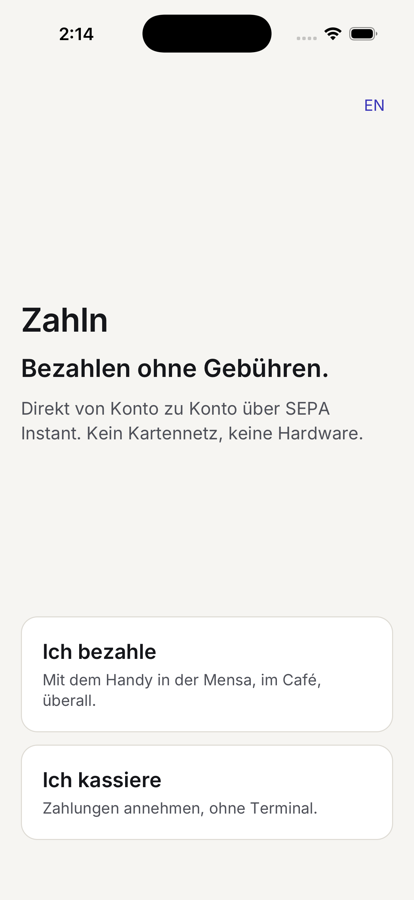
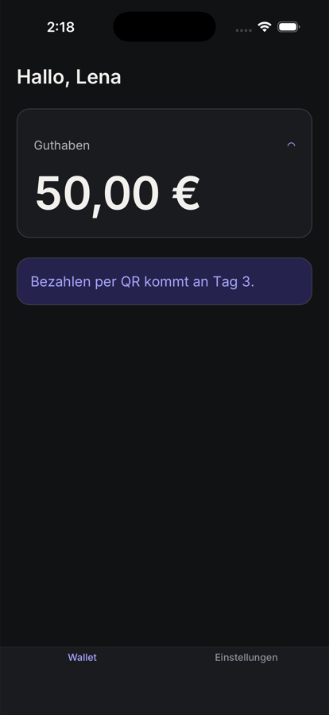

# zahln

An interview MVP of [Zahln / ZYSYGY](https://zysygy.de): zero-fee account-to-account payments over SEPA Instant.
It has a merchant till with a one-time QR code, a student wallet, a realistic payment backend, and a web console.

> Work in progress. The code is built day by day following the guides in [`docs/days`](docs/days/README.md).

## Run it
```bash
cp .env.example .env
pnpm install
pnpm db:up && pnpm db:migrate && pnpm db:seed
pnpm api          # API on :4000 (OTP is always 123456 in dev)
pnpm mobile       # Metro
cd apps/mobile/ios && pod install && cd -
pnpm --filter @zahln/mobile ios       # or: android
```
Demo logins: `0151 0000 0001` (Lena, student) · `0151 0000 0010` (Mila, Café Mila).

| | |
|---|---|
|  |  |

## Docs
- [Plan](docs/PLAN.md): product understanding, demo script, architecture, schedule
- [Tech decisions](docs/DECISIONS.md): every library choice, its trade-offs, and the interview questions it answers
- [Design system "Quittung"](docs/DESIGN_SYSTEM.md): light and dark tokens, typography, components
- [Daily guides](docs/days/README.md): Day 1 to Day 7

## Stack
Bare React Native 0.88 · TypeScript · NativeWind · React Navigation · TanStack Query · Zustand ·
Fastify · Postgres · Drizzle · Vite + React + shadcn/ui · pnpm + Turborepo · Biome · Vitest · Jest · Maestro
