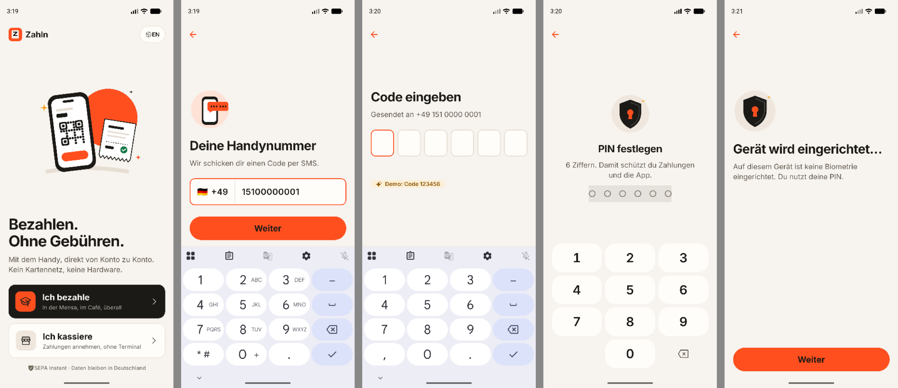
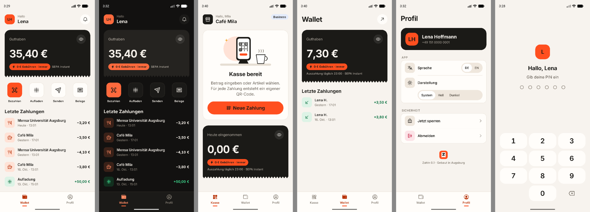

# Day 2: The app shell (RN, design system, onboarding, PIN, biometrics) ✅ Done

> **Status: complete (2026-10-18).**
> - Bare RN 0.88 builds and runs on the **iOS simulator** (iPhone 17 Pro, iOS 26.5) and the **Android emulator** (Pixel 10).
> - A student (Lena) onboarded on iOS; a merchant (Mila, Café Mila) onboarded on Android.
> - PIN lock, wrong-PIN counter, light/dark and de/en verified on device.
> - **127 tests green:** 83 shared, 40 API, 4 mobile.
> - Typecheck and Biome are clean.
>
> Deviations and honest caveats are at the bottom.




## Goal
"Bare React Native runs on iOS and Android from one codebase, themed with my own design system in light and dark,
in German and English, and both a student and a merchant can onboard with a PIN and Face ID."

## Why it matters for the interview
- JD: *"You own the app. iOS and Android, one codebase, from an empty repository."*
- JD: *"PIN and biometric setup, device binding, session handling."*
- JD: *"Accessibility built in from the first screen."* Today is the first screen.
- Bonus: *"You have built or maintained a design system inside an app."*

---

## Concepts to understand first

### 1. New Architecture (RN 0.88)
- **Fabric**: the renderer.
- **TurboModules**: lazily loaded native modules with typed specs (Codegen).
- **JSI**: lets JS call C++ directly, without the old JSON bridge.
- 0.88 is "bridgeless" by default; the DevTools target literally says *React Native Bridgeless*.
- Reanimated 4, vision-camera 5, MMKV 4 (Nitro modules) and your Day-6 modules all need it.

### 2. Metro in a monorepo
Metro only watches the app folder by default. `apps/mobile/metro.config.js` sets:
- `watchFolders: [workspaceRoot]`, so `@zahln/shared` hot-reloads
- `resolver.nodeModulesPaths`, pointing at the hoisted root `node_modules`
- `unstable_enablePackageExports`, so `@zahln/shared/tokens` subpath exports resolve

There's **exactly one copy** of `react` / `react-native` (verified). Android's Gradle files also point at the hoisted
`node_modules` (`settings.gradle`, `app/build.gradle` → `../../../../node_modules/...`).

### 3. NativeWind 4 + tokens (one source of truth)
```
packages/shared/src/tokens/index.ts       ← colours (light + dark), type scale, spacing, radius, motion
packages/shared/src/tokens/tailwind.ts    ← generates the Tailwind theme + per-theme CSS variables
apps/mobile/tailwind.config.js            ← requires tailwind.ts (Tailwind loads it with jiti, TS works)
apps/mobile/src/ds/theme.tsx              ← applies vars(cssVariables(scheme)) at the root
```
- Every colour class (`bg-surface`, `text-text-primary`) resolves to `var(--color-…)`, so **the same class is correct in
  light and dark**. No `dark:` variants, no raw hex in screens.
- Theme follows the system by default; Settings can force Light/Dark (stored in MMKV).

### 4. Keychain with biometric access control
`apps/mobile/src/lib/secure.ts`: every secret is `WHEN_UNLOCKED_THIS_DEVICE_ONLY`, meaning it's not readable while the phone is
locked and never in iCloud or device backups.

| Keychain item | Access control | Contents |
|---|---|---|
| `de.zahln.device` | — | random device ID (device binding) |
| `de.zahln.session` | — | session token (read only after an app-level unlock) |
| `de.zahln.pin` + `de.zahln.pin-attempts` | — | the PIN and the failed-attempt counter |
| `de.zahln.biometric-unlock` | **`BIOMETRY_CURRENT_SET`** + secure hardware | a random secret; Face ID / fingerprint must release it |

- `CURRENT_SET`: adding a new face or finger invalidates the item, so an attacker can't enrol their own face.
- The attempt counter lives in the keychain, not MMKV, so clearing app data doesn't reset it. Verified: the
  counter survived a cold restart on iOS ("3 attempts left").

### 5. Device binding (built in the API)
1. The app generates a UUID with the platform's secure RNG (`react-native-get-random-values`, never `Math.random`).
2. It stores the UUID in the keychain.
3. It sends the UUID with `POST /devices`.

The server stores only `sha256(sessionToken)` per device. Every request sends `Authorization: Bearer` **and** `x-device-id`. A
token used from another device ID is rejected (tested). Sign-out revokes the device row.

### 6. PIN rules (`packages/shared/src/auth.ts`)
- 6 digits.
- `isWeakPin` rejects repeated digits, straight runs (234567 / 876543) and common PINs (123123, 159753…).
- `pinCooldownMs`: 5 free attempts, then 30 s, 60 s, 120 s … capped at 1 h.
- PIN entry uses the same `Keypad` primitive as the Day-3 amount entry (`mode="pin"`).

### 7. Session lock (`apps/mobile/src/lib/session.ts`)
- States: `booting → onboarding | locked → ready`.
- A **cold start with a session always starts `locked`**.
- `AppState` background for ≥ 60 s → `locked` on return; a quick app switch doesn't lock (both unit-tested).
- Locking clears the in-memory auth (`setAuth(null)`), so a locked app can't make authenticated calls.
- Money screens are **not mounted** until `ready`: the root navigator swaps whole trees (Onboarding / Lock /
  ConsumerTabs / MerchantTabs), so a deep link can't reach a wallet behind the lock.

---

## What was built

### A. Scaffold ✅
- [x] `@react-native-community/cli init` → `apps/mobile` (`@zahln/mobile`, RN 0.88.0, React 19.3)
- [x] Bundle ID `de.zahln.mvp`, display name **Zahln** (iOS + Android)
- [x] Metro monorepo config + Android Gradle paths for hoisted `node_modules`
- [x] Native permissions:
  - [x] iOS: `NSFaceIDUsageDescription`, `NSCameraUsageDescription` (German copy)
  - [x] Android: `USE_BIOMETRIC`, `CAMERA`
  - [x] Android: `allowBackup="false"`, kept from the template (matches "no backups of secrets")
- [x] Libraries installed and **building on both platforms**:
  - React Navigation 7 (native-stack + bottom-tabs)
  - NativeWind 4.2.7 / Tailwind 3.4.19
  - Reanimated 4.7 + worklets 0.13, Gesture Handler 3.4
  - react-native-keychain 10, MMKV 4 (Nitro), vision-camera 5.2 (Nitro), FlashList 2
  - TanStack Query 5, Zustand 5, React Hook Form 7 + Zod 4, i18next 26

### B. Design system v1 (`apps/mobile/src/ds`) ✅

| Primitive | What it does |
|---|---|
| `theme.tsx` | ThemeProvider: system/light/dark → CSS variables; `useTheme()` for the few APIs that need raw colours |
| `Text` | Type scale → font file (Inter Regular/Medium/SemiBold), tabular numerals for amounts, letter-spacing, Dynamic Type cap 1.5× for amounts |
| `Button` | primary / secondary / tertiary / destructive / pay; 56/48 pt; loading + disabled states; a11y role/state |
| `Screen` | Safe area, 20 pt gutter, scroll, footer pinned above the keyboard on **both** platforms |
| `Card` | Surface card; a `bg-*` className replaces the default surface |
| `AmountDisplay` | `Intl` formatting (6,30 € / €6.30), discreet mask (•••,•• €), spoken label ("6 Euro 30 Cent") |
| `Keypad` | 3×4, keys ≥ 64 pt, `mode="amount"` (00 key) or `mode="pin"` (biometric key) |
| `PinDots`, `StatusBadge`, `TextField` | `StatusBadge` = icon + text + colour, never colour alone |

### C. Navigation + i18n ✅
- [x] Root navigator swaps trees by session state; typed params (`app/navigation/types.ts`)
- [x] Navigation theme built from the tokens (light/dark)
- [x] i18next with `de` default + `en`; strings live in `packages/shared/src/i18n` (a test enforces identical keys)
- [x] `useT()` → `t()`, `locale`, `money()`; switching language is instant, including tab labels and money format

### D. Onboarding ✅
1. **Welcome**: "Ich bezahle" / "Ich kassiere" + DE/EN switch
2. **Phone**: normalises `0151 …` / `+49 …` / `0049 …` to E.164 and validates German mobiles
3. **OTP**: auto-submits at 6 digits; dev builds show "Demo: Code 123456"; 5 attempts per code
4. **Name** (new users only)
5. **Merchant**: the number must belong to staff of a business; shows business, role and plan
6. **PIN create** (weak PINs refused) → **PIN confirm**
7. **Biometrics**: enable stores the secret and reads it back once (proves it works); skip → PIN only;
   unavailable → "Du nutzt deine PIN"
8. `POST /devices` → save PIN + session in the keychain → `ready`

The API side, all in `apps/api/src/lib/auth.ts` and `routes/auth.ts`, with **11 new tests**:

| Endpoint | Behaviour |
|---|---|
| `POST /auth/otp` | stores a hashed code; 5-min TTL; `devCode` only when `DEV_AUTH=true` |
| `POST /auth/verify` | locks the challenge row; timing-safe compare; 5 attempts; one use; returns `isNewUser` + memberships |
| `POST /devices` | verification token single-use, 15 min; creates the user + wallet if new; session token stored hashed |
| `GET /me`, `DELETE /devices/current` | profile; sign out revokes the device |
| Auth plugin | Bearer + `x-device-id`; the Day-1 `x-user-id` shortcut now only works when `DEV_AUTH=true` |

### E. Lock screen ✅
- [x] Auto-prompts biometrics if enabled; biometric key on the keypad; PIN fallback
- [x] "Falsche PIN. Noch 4 Versuche vor der Sperre." → cooldown countdown after 5
- [x] Settings: account, language, appearance, **"Entsperren mit Biometrie" toggle**, lock now, sign out (revokes the device)

---

## Verified on devices

| Check | iOS (iPhone 17 Pro sim) | Android (Pixel 10 emu) |
|---|---|---|
| App builds and launches | ✅ | ✅ |
| Onboarding | ✅ Lena (student), Face ID on | ✅ Mila (merchant, Café Mila), PIN only |
| Weak PIN refused | — | ✅ "Diese PIN ist zu leicht zu erraten." |
| Wallet from authenticated API | ✅ 50,00 € | ✅ merchant wallet 0,00 € |
| Cold start → lock screen | ✅ | ✅ |
| Background 5 s → still unlocked; 65 s → lock | — | ✅ (real AppState, not just the unit test) |
| Wrong PIN → counter | ✅ (persisted across restart) | ✅ "Noch 4 Versuche" |
| Right PIN → unlocked | (unit-tested; see caveats) | ✅ |
| Dark mode | ✅ every surface re-themed | — |
| de ↔ en live switch | ✅ incl. tab labels and "€50.00" | — |
| Screen-reader labels | — | ✅ accessibility tree shows labels like "Ich bezahle. Mit dem Handy in der Mensa…", "0 von 6 Ziffern eingegeben", "Löschen" |
| Footer above keyboard | ✅ | ✅ after the fix below |

All screenshots: [docs/screenshots](../screenshots/).

---

## Commands
```bash
pnpm db:up
pnpm db:migrate
pnpm db:seed
pnpm api
pnpm mobile
cd apps/mobile/ios && pod install
pnpm --filter @zahln/mobile ios
pnpm --filter @zahln/mobile android
xcrun simctl ui booted appearance dark
```

The API needs `DEV_AUTH=true` in `.env` (fixed OTP 123456, `x-user-id` shortcut).

Enrol Face ID on the iOS simulator:
```bash
xcrun simctl spawn booted notifyutil -s com.apple.BiometricKit.enrollmentChanged 1
```
```bash
xcrun simctl spawn booted notifyutil -p com.apple.BiometricKit.enrollmentChanged
```

Demo logins (OTP 123456):

| Phone | Who |
|---|---|
| 0151 0000 0001 | Lena, student, 50 € |
| 0151 0000 0010 | Mila, owner of Café Mila |
| 0151 0000 0020 | Ali, Döner Ali (Free) |

---

## Design upgrade: "Ember and ink" (same day, second pass)
The first pass was functional but "very decent". The second pass aimed at founder-level craft:

| Area | What changed |
|---|---|
| Palette | **Ember and ink**: warm paper `#F7F3EE`, ink `#1B1A17`, ember `#FF4F1F`, saffron accent, raspberry danger. Contrast unit-tested in both themes |
| Brand mark | A receipt with a torn edge carrying a bold Z, the "Quittung" idea in one shape. Used in-app, as the app icon (iOS light/dark/tinted, Android adaptive + monochrome) and on the splash |
| Icons | **Phosphor**, curated registry of ~37 icons imported by path (no 1,500-icon bundle). Weights carry meaning: regular / fill (active) / duotone (tiles) / bold (buttons) |
| Illustrations | Custom geometric SVG from the tokens (welcome, OTP, shield, Face ID scan, empty receipts, till). They re-theme in dark mode. Gentle finite animations |
| Signature motif | **Torn-receipt edge** under the ink balance card |
| Motion | `PressableScale` spring on every tappable; staggered fade-up; PIN dots pop and shake; skeleton pulse; all respect Reduce Motion |
| Haptics | Mapped to outcomes: tap, selection, success, error. **Never blocks the action** (wrapped and fired after `onPress`) |
| Screens | Welcome hero; onboarding progress bar computed from the real steps; +49 phone field; 6-box OTP with resend timer; ink balance card; quick actions; transaction list with category tiles, relative dates, skeletons and an illustrated empty state; till hero; grouped Profile; custom tab bar |
| Data | Seeded realistic history (Mensa, Café Mila); merchants see **"Lena H."** (data minimisation, tested); the till shows **today's** takings, not the balance |
| Launch | Ink splash on both platforms; the iOS React root view is ink too, so there's no white flash |

Craft bugs found in this pass:
- The custom spacing scale lacked `1.5`, `11` and `px`, so `h-1.5`, `h-11` and `h-px` silently rendered nothing.
- Infinite decorative animations blocked Android UI automation's idle detection (Maestro too). They're now finite.
- The first icon idea (a zigzag Z) read as a squiggle; it was replaced after rendering four variants side by side.

## Bugs found and fixed while verifying
1. **Android: primary button hidden behind the keyboard.** RN 0.88 runs Android **edge-to-edge**, where
   `windowSoftInputMode=adjustResize` no longer shrinks the window and `KeyboardAvoidingView` didn't move content.
   Fix: `Screen` pads by the keyboard height from `Keyboard` events on Android (KAV stays on iOS).
   *Interview point: "edge-to-edge changed keyboard handling; I verified on a device, not just in code."*
2. **`Card` ignored a custom background** (`bg-surface` + `bg-info-subtle` in one string; CSS order decided).
   Fix: a `bg-*` in className replaces the default.
3. **Third-party dev warning** "ImageBackground is deprecated": NativeWind's css-interop registers every RN component at
   startup. Silenced with `LogBox.ignoreLogs` (commented: remove with NativeWind 5).
4. **Zod 4 needs `@babel/plugin-transform-export-namespace-from`** in Metro (`export * as`). Pinned the Babel 7 line
   (7.29.7). The latest (8.x) targets Babel 8.

## Deviations from the plan
| Planned | Actual | Why |
|---|---|---|
| Inter Display for amounts | Inter SemiBold with tighter tracking | Google Fonts doesn't serve a static Inter Display cut. Fonts are named by PostScript name (`Inter-SemiBold`) so one string works on iOS and Android |
| Device key pair | Random device UUID + server-side hashed session bound to it | Simpler for Day 2; the hardware key that signs payments (Secure Enclave / StrongBox) is the Day-6/next step |
| PIN verified on server | PIN in keychain, compared on device, attempt counter in keychain | MVP. Production: verify server-side, rate-limited per device, so a jailbroken phone can't brute-force offline |
| — | Settings got a biometrics on/off toggle | Needed to test the PIN path, and users need it anyway |
| `react-native-get-random-values` not planned | Added | Hermes has no `crypto.getRandomValues`; IDs and secrets must come from a secure RNG |
| Storybook today | Moved to Day 6 (as planned in DAY-6.md) | — |

## Honest caveats (say these before they're asked)
- **The iOS simulator doesn't enforce the biometric keychain ACL like a device.** The protected item was released
  without a visible prompt, even after an enrolment change. `BIOMETRY_CURRENT_SET` must be verified on a **real iPhone**.
- **The iOS simulator's tap injection dropped and coalesced taps** while the Mac was busy, so the iOS correct-PIN unlock
  was verified on Android plus Jest (`checkPin`), not on the iOS simulator. The app itself was idle (0.7 % CPU).
- **Android 16 asks for "nearby devices" permission in debug builds**, because the app talks to Metro and the API
  on the host's local network. Production talks to a public HTTPS API, so no prompt.
- **Local network workaround, not in the repo:** `repo1.maven.org` was throttled (~200 B/s) on this network, so the
  Android build used a Gradle init script pointing at Google's Maven Central mirror. The project's Gradle config is
  unchanged.

## Done when
- [x] Both platforms onboard: Lena (student) on iOS, Mila (merchant) on Android
- [x] Killing and reopening the app → lock screen (Face ID or PIN), not onboarding again
- [x] 60 s in the background → lock; a 5 s app switch → no lock (verified on Android)
- [x] Dark mode re-themes every screen (iOS verified)
- [x] English without restart; amounts as `€50.00` in English and `50,00 €` in German
- [x] Screen-reader labels and roles on onboarding controls (Android accessibility tree)

## Interview drill
1. "What does the New Architecture change for you as an app developer?"
2. "Is a Face ID prompt enough to protect a session token? What is `BIOMETRY_CURRENT_SET` for?"
   *Then add: "and I know the simulator doesn't enforce it, so I'd test it on a device."*
3. "What happens when the user adds a new fingerprint?"
4. "How do you stop the app switcher from leaking the balance?" (Day 6: SecureScreen)
5. "How did you set up dark mode so screens can't use the wrong colour?"
   *CSS variables from one token file; no raw hex; same class in both themes.*
6. "What broke on Android that didn't break on iOS?" *(new) Edge-to-edge keyboard handling.*
7. "Why is the PIN counter in the keychain and not in AsyncStorage/MMKV?" *(new)*

## Commit
```
feat: day 2 app shell: bare RN 0.88, Quittung design system, onboarding, PIN, biometrics, device-bound sessions
```
