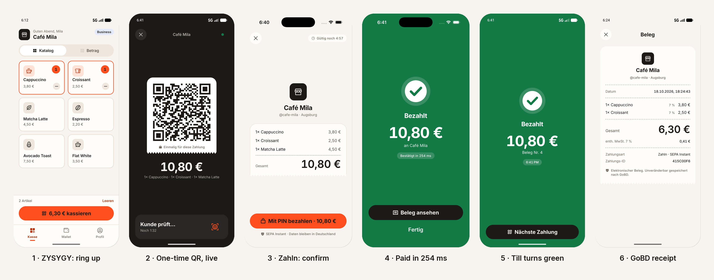

# Day 4: The payment moment (Act 1) ✅ Done

> **Status: complete (2026-10-18).** Act 1 runs across two devices with no manual API calls: ZYSYGY on the Android
> emulator rings up an order and shows a one-time QR; Zahln on the iOS simulator opens it, the till flips to
> "Kunde prüft…" by itself (SSE), the payer confirms with the PIN, and both phones show **Bezahlt** within the same
> second (**254 ms** time to confirmation on iOS, 953 ms on a loaded Android emulator).
> **153 tests green:** 96 shared, 48 API (including a real SSE stream), 9 mobile-core (the payment hook's idempotency rules).
>
> 
>
> *Screens 3, 5 and 6 were captured before three small fixes listed under "As built" (countdown, 24 h time, receipt number).*

## Goal
"Café Mila's till builds an order from the catalogue, shows a one-time QR valid for 5 minutes, Lena scans it,
confirms with Face ID, and both phones show Bezahlt in about a second, with the merchant wallet updating live."

## Why it matters for the interview
- JD: *"That moment is the whole company and it belongs to this seat."*
- JD: *"QR scan… merchant and amount confirmation, biometric authorisation, receipt. Measured in milliseconds."*
- Site: *"Every payment. Its own QR code. Unique to this transaction… valid for 5 minutes."*
- This is **Act 1** of the demo.

---

## Concepts to understand first

### 1. The QR carries a reference, not the payment
QR content: `https://pay.zahln.de/i/<intentId>.<sig>`, where `sig` is an HMAC that stops someone guessing intent IDs.
The consumer app **fetches the intent from the API** and shows the server's merchant name and amount, never values
decoded from the QR. A sticker over the merchant's QR can't silently change the payee or amount.

Using an `https` URL also means a normal phone camera opens the app (universal link / app link) later.

### 2. Server-Sent Events (SSE)
`GET /intents/:id/events` keeps an HTTP response open and writes lines like `event: status\ndata: {...}\n\n`.
- The till subscribes to its intent; the console and the Zahln Web dashboard subscribe too (Days 6–7).
- SSE is a **hint**. When the connection drops, the client fetches `GET /intents/:id`. The truth is always the REST status.
- In RN, use `react-native-sse` or a small `fetch`-stream reader.

### 3. Measuring time to confirmation
Measure `t0` = when the user approves Face ID, and `t1` = when the `paid` status is rendered. Show `t1 − t0` in a dev overlay
("Bestätigt in 840 ms"). JD: *"You measure performance instead of asserting it."*

### 4. Why the till shows the cart
Like Stripe Terminal: the customer sees what they're paying for on the merchant device before scanning.
Fewer disputes.

### 5. Screen brightness
Raise brightness while the QR is visible, and restore it afterwards. A tiny native call. Use a small library or write it as a warm-up for Day 11.

---

## Tasks

### A. API additions (≈1 h)
- [ ] HMAC-signed intent reference (`INTENT_SIGNING_SECRET` in env)
- [ ] `GET /intents/:id/events` (SSE) emitting `scanned`, `paid`, `expired`, `refunded`
- [ ] `POST /intents/:id/scanned`: the consumer app reports a scan, so the till shows "Kunde prüft…"
- [ ] An in-process event bus (EventEmitter) that the payment transaction publishes to **after commit**

### B. Merchant till (≈2.5 h)
- [ ] `MerchantTabs`: **Kasse** (till), **Wallet**, **Mehr** (more)
- [ ] Till with tabs **Katalog / Betrag** (catalogue / amount)
  - [ ] Catalogue grid (FlashList, `numColumns`), tap to add, quantity badge, running total, "QR erstellen" (create QR)
  - [ ] Amount keypad (cents-first), "6,30 € kassieren" (charge 6,30 €)
- [ ] `QRPanel` screen:
  - [ ] White QR (`react-native-qrcode-svg`, error correction M, quiet zone 4)
  - [ ] Amount + merchant name + line items
  - [ ] Countdown ring (Reanimated) + "Noch 4:12" (4:12 left)
  - [ ] Live state: Warten auf Scan → Kunde prüft → **Bezahlt**
  - [ ] Brightness up on focus, restored on blur
- [ ] Bezahlt flood screen (merchant): amount-hero, a ticking time, success haptic, auto-return after 2.5 s

### C. Consumer pay flow (≈2.5 h)
- [ ] `ConsumerTabs`: **Wallet**, **Bezahlen** (scan), **Verlauf** (history)
- [ ] Scanner (vision-camera `useCodeScanner`, QR only), with the camera permission explained first (pre-prompt screen)
- [ ] Parse the URL → `GET /intents/:id` → **Confirm** screen: merchant, amount, items, "Mit Face ID bezahlen · 6,30 €" (pay with Face ID)
- [ ] Face ID via a keychain read (the biometric gate) → `POST /intents/:id/pay` with a fresh `Idempotency-Key`
      **persisted before sending** (Zustand + MMKV or keychain, so it survives an app kill)
- [ ] Drive the UI from the `paymentAttempt` reducer in `@zahln/shared`
- [ ] Bezahlt screen (consumer) mirrors the merchant one; a receipt link
- [ ] **Simulator tip:** the iOS simulator has no camera. Add a dev-only "QR-Link einfügen" (paste QR link) button that reads the
      intent URL from the clipboard. On the till, add a dev-only "Link kopieren" (copy link). Both are hidden in release builds.

### D. Wallets + receipt (≈1 h)
- [ ] Consumer wallet: balance (`AmountDisplay` hero, discreet toggle), top-up (mock), last 5 transactions
- [ ] Merchant wallet: today's total, balance, "Wird täglich um 23:00 ausgezahlt" (paid out daily at 23:00), "Jetzt auszahlen" (pay out now; mock withdraw → postings)
- [ ] Receipt screen: receipt number (sequential per merchant), timestamp, items, VAT 7 % / 19 % breakdown, payment ID

---

## As built (deviations and honest caveats)
| Plan said | What happened | Why |
|---|---|---|
| Tabs Wallet / Bezahlen / Verlauf (consumer), Kasse / Wallet / Mehr (merchant) | Kept two/three tabs; **Bezahlen** is the primary wallet action that opens the scanner as a full-screen modal; the QR panel and Bezahlt sit on a stack above the till's tabs | Paying is a modal moment, not a place you browse to; history is already on the wallet |
| `useCodeScanner` from VisionCamera | **iOS:** VisionCamera's object output (AVFoundation's native QR detector). **Android:** `react-native-vision-camera-barcode-scanner` (ML Kit). One hook, `useQrOutput`, with `.ios.ts` / `.android.ts` files | VisionCamera 5's code scanner is iOS-only. ML Kit ships no arm64 iOS-simulator binaries (with it linked, Xcode can't target a simulator on Apple Silicon) and adds ~20 MB, so iOS keeps the native detector and the ML Kit pod is unlinked on iOS via `react-native.config.js` |
| Dev "Link kopieren" / "QR-Link einfügen" via the clipboard | A dev-only **"Demo: QR der Kasse laden"** button that asks `GET /dev/latest-intent` (only when chaos/dev routes are on) | No clipboard native module needed, and it works across two different simulators |
| Face ID via a keychain read | Biometrics if enabled, otherwise a **PIN sheet** with the same cooldown rules as the lock screen | The emulator and fresh simulators have no enrolled biometrics; the PIN path is the honest fallback |
| Brightness up on the QR panel | Not done | Moved to Day 11 with the other native modules |
| Merchant "Jetzt auszahlen" (mock payout) | Not done | Moved to Day 5; the wallet tab now shows today's takings and the payout schedule |
| `react-native-sse` | Used, wrapped in `useIntentStatus`: SSE first, polling every 2 s on error, refetch on foreground, final states are sticky | SSE is a hint, not the truth |

Fixes found while testing on devices (all done):
- **Safe area in native full-screen modals (iOS):** `SafeAreaView` reported zero insets there, so headers sat under the Dynamic Island. New `SafeArea` (mobile-ui) applies the root provider's insets explicitly.
- **Countdown:** first version counted 5 minutes from when the *screen* opened, so a payer saw "4:57" for a code that had 1:30 left. It now counts down to the server's `expiresAt`.
- **Receipt number:** the pay screen kept the pre-payment intent; the hook now fetches the paid intent (`paidIntent`) for the receipt.
- **Till time** used the device locale ("6:41 PM"); it now follows the app language ("18:41").
- **Radius scale:** `rounded-t-2xl` doesn't exist in our tokens (scale ends at `xl`), so it silently rendered square corners, the same failure mode as the spacing keys on Day 2. A lint check for unknown utility classes is on the Day 12 list.
- **Env:** `INTENT_SIGNING_SECRET` must now be ≥ 32 characters (validated at startup); `.env.example` says how to generate one.

Known edge case (Day 5): if the till auto-locks while a QR is open, unlocking returns to the till, not the open QR, and the cart isn't cleared even if the customer paid. Day 5 restores an open intent after unlock.

## Files you'll create
```
apps/api/src/{routes/events.ts, lib/eventBus.ts, lib/intentRef.ts}
apps/merchant/src/features/{TillScreen, CatalogueGrid, AmountPad, QRPanelScreen, PaidScreen, MerchantWalletScreen}.tsx
apps/consumer/src/features/{WalletScreen, ScanScreen, ConfirmScreen, PaidScreen, ReceiptScreen}.tsx
packages/mobile-core/src/payments/{usePayment.ts, useIntentEvents.ts, idempotency.ts}
packages/mobile-ui/src/{QRPanel, Countdown}.tsx
```

## Pitfalls
- **Publishing the `paid` event before the database commit.** The till turns green and then the transaction rolls back. Publish after commit only.
- **The scanner firing 30 times a second.** Debounce, and stop scanning after the first valid code.
- **Generating a new idempotency key on re-render or retry.** It's created once per *attempt* when the user taps pay, and reused for every status check.
- **Trusting the QR content.** Always re-fetch the intent.
- **SSE through the Metro dev proxy / Android emulator:** use `10.0.2.2:4000` for Android, and allow cleartext for local dev only.

## Done when
- [ ] **Act 1 runs on two simulators** (Zahln on iOS, ZYSYGY on Android, or both on iOS) with no manual API calls
- [ ] Time to confirmation is shown, and it's under 1.5 s on the simulator with the rail in `ok` mode
- [ ] The intent expires after 5 minutes, and paying an expired one shows Abgelaufen
- [ ] Both wallets and the receipt show the right amounts in de and en, in light and dark

## Interview drill
1. "Walk me through what happens between scanning and Bezahlt, at the network level."
2. "Why doesn't the QR contain the amount?"
3. "What if the SSE connection drops while the customer is paying?"
4. "How did you measure time to confirmation, and what dominates it?"
5. "How would this work with a normal camera app instead of in-app scanning?" (universal links)

## Commit
```
feat(api): signed intent references and SSE status events
feat(mobile): merchant till with catalogue, keypad and live QR panel
feat(mobile): consumer scan, confirm with Face ID and pay
feat(mobile): wallets and GoBD-style receipt
```
