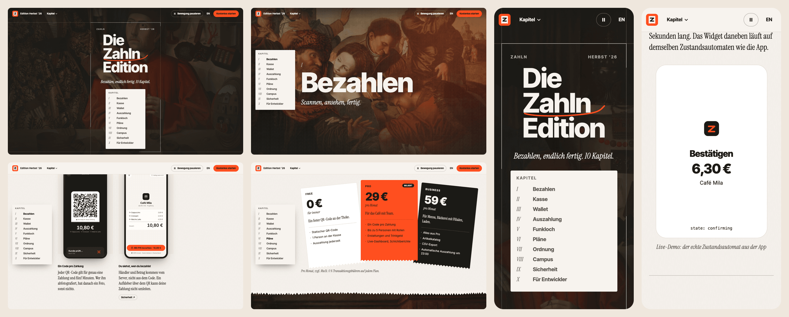

# Day 9: The Zahln Edition I: content, art and static layout ✅ Done

> **Status: complete (2026-10-18).** `apps/landing` is a Next.js 16 static export (`/` German, `/en/` English) that
> reads completely with JavaScript off: ten chapters of real copy, twelve licence-recorded CC0 / public-domain
> paintings graded into AVIF + WebP, our own title lettering, torn-receipt paper sections, CSS device frames with
> real app screens, fanned plan cards, closing CTA and footer. **Lighthouse (mobile): Accessibility 100,
> Best Practices 100, SEO 100, CLS 0.** 26 unit tests (torn edge, copy parity, token contrast).
>
> 

## Goal
"The landing page reads beautifully with JavaScript turned off. It has ten chapters with real copy in German and
English, licence-clean Old Master art cut with torn-receipt edges, our own title lettering, three type voices,
and a perfect accessibility score."

## Why it matters for the interview
- The founders "care about craft a lot". This page is the first thing they'll see if you send a link.
- Building it static-first (content, structure, typography) before motion is how you get a page that degrades
  gracefully and passes accessibility. It's a process you can explain.
- Full teardown and spec: [LANDING.md](../LANDING.md).

---

## Concepts to understand first

### 1. Static first, motion second
Day 9 ships HTML + CSS that already *looks* like the final page: sticky index, chapter heroes, torn edges, paper
sections. Day 10 adds scroll-linked motion on top. If JS fails, the reader loses nothing but motion.

### 2. Art sourcing and licences
- Collections: Rijksmuseum (CC0), The Met Open Access (CC0), National Gallery of Art Open Access (CC0).
- Search terms: *money changer, moneylender, tax collector, merchant, market, banker, counting*. Candidates
  include Quentin Matsys' *The Moneylender and his Wife* (check which collection holds an open-access file),
  Marinus van Reymerswaele's *The Moneychangers*, and Dutch market scenes.
- Every image gets a row in `apps/landing/ASSETS.md`: title, artist, year, collection, object URL, licence. No
  row, no ship.
- Treatment (a script, so it's repeatable): crop to 16:10 and 9:16, grade toward ink shadows and ember highlights,
  add grain, export AVIF + WebP at 640/1280/2048 widths with a blur placeholder.

### 3. Torn-receipt edges, deterministic
`tornEdge(seed, width, amplitude)` generates an SVG path from a seeded value-noise function. The same seed
produces the same path on server and client, so there's no hydration mismatch. It is used as a `mask-image`
(data URL) on the paper section's top and bottom. It shares the algorithm with the app's `ReceiptEdge`; port it
into `@zahln/shared` so both use one implementation.

### 4. Title lettering
"Die Zahln Edition" is set in Inter Tight 800, converted to SVG paths (opentype.js at build time), with a
hand-drawn ember swash on the Z and an `sr-only` text twin. Paths stay drawable on Day 10
(`pathLength=1`).

### 5. Type voices (strict jobs)
- Inter Tight 700/800: names of things (chapter titles, nav, labels).
- Instrument Serif (italic for statements): what it means to you.
- Pinyon Script: exactly one initial per chapter.
- Inter: UI.

### 6. Real product media
Record 6–8 short clips (5–8 s, loopable) from both apps on the simulator: scan → pay, the till QR countdown,
payment received, the flood, the checking state, settings/dark mode. Run them through `ffmpeg` to H.264 MP4 +
WebM at about 2.5 Mbps, and grab a poster frame. Show them in a CSS device frame (iPhone and Pixel), not a
screenshot of a frame.

---

## Tasks

### A. Setup (≈1 h)
- [ ] `apps/landing`: Next.js 16, `output: 'export'`, Tailwind 4 + `packages/web-ui` theme, `next/font` (Inter, Inter Tight, Instrument Serif, Pinyon Script)
- [ ] i18n: `/` (de) and `/en`, with copy keys in `@zahln/shared/i18n/landing.*`

### B. Content (≈2 h)
- [ ] Write all ten chapters (title, serif statement, 2–4 feature articles each: label + blurb + link) in German, then English
- [ ] Have a German speaker or a careful pass check the tone: confident, warm, never cute

### C. Art + media (≈2.5 h)
- [ ] Source 11 paintings (intro + 10 chapters) and fill `ASSETS.md`
- [ ] `scripts/grade-art.ts` (sharp): crop, grade, grain, multi-format, blur placeholder
- [ ] Record and encode the app clips; posters

### D. Static layout (≈3 h)
- [ ] Top bar, intro frame with the lettering, chapter list
- [ ] Sticky left chapter index with Roman numerals and `aria-current` (via CSS scroll-driven styling where supported; otherwise the static state)
- [ ] Chapter hero: sticky art + giant title; paper section with the torn edge; 12-col feature grid; device-frame video component; fanned plan cards
- [ ] Closing CTA + footer (Impressum and Datenschutz placeholders, which a German site legally needs)
- [ ] Mobile layout: index → menu sheet; heroes 9:16 crops; shallower tears

---

## As built (deviations and honest caveats)
| Plan said | What happened | Why |
|---|---|---|
| Tailwind 4 + `packages/web-ui` theme | Tailwind 4 themed straight from `@zahln/shared/tokens`: `lib/tokens.ts` renders the palette as `--z-*` variables on `<html>`, `app/globals.css` maps them with `@theme inline` (and resets Tailwind's default colours, so only token colours exist) | `packages/web-ui` belongs to the console stream running in parallel; the tokens are the single source either way |
| Copy keys in `@zahln/shared/i18n/landing.*` | `apps/landing/content/{de,en}.ts` with a shared `Copy` type, plus `test/content.test.ts` (same keys and array lengths, same ids/anchors/media, no empty strings, links point at real chapters, plan prices) | Long-form editorial copy only this page uses; the shared i18n package was off-limits for this stream |
| Port `tornEdge` into `@zahln/shared` | `apps/landing/lib/tornEdge.ts` (mulberry32 PRNG + two-octave value noise + jittered blade teeth), 9 unit tests. The masks are generated once into `app/tears.gen.css` (`scripts/tears.mjs`, 3 seeded shapes, the bottom tear is the same mask mirrored) | `packages/*` were off-limits. Inline masks put ~20 KB of path data into every page *and* its RSC payload (HTML was 53 KB); as CSS they cost 3 KB gzipped once. The mobile `ReceiptEdge` still has its own zigzag: moving both into shared is a follow-up |
| 11 paintings (intro + 10) | **12** (a closing painting too), 5 from The Met (CC0) and 7 from the Rijksmuseum (Public Domain Mark), fetched only from the museums' own APIs by `scripts/fetch-art.mjs`, which rejects anything the API doesn't mark public domain. Rows and raw API evidence: [ASSETS.md](../../apps/landing/ASSETS.md), `art-src/records.json` | No Matsys or Reymerswaele money-changer is available as a CC0 file from our three sources, so Petrus Christus' *A Goldsmith in his Shop* (1449, scales and coins) opens the page. One Rijksmuseum "money-changer" was rejected on taste (see ASSETS.md) |
| `scripts/grade-art.ts` | `scripts/grade-art.mjs` (+ `fetch-art`, `screens`, `letter-title`, `tears`, `check-bundle`), all plain Node | Runs with `node` and no TS runner. Grading: trim, focal-point crops 16:10 and 9:16, desaturate, soft-light ember highlight + ink vignette, grain, AVIF + WebP at 640/960/1280/2048 (portrait 640/960/1280), 16 px blur placeholder. ~10 min for all 12 (AVIF effort 5) |
| Record 6–8 app clips (ffmpeg, posters) | **Not done.** Devices show stills cropped from `docs/screenshots` (`scripts/screens.mjs`, 15 screens) in a CSS iPhone/Pixel frame. `DeviceFrame` has a `video` prop (MP4 + WebM + poster, sources attached only in view) ready for the clips | No simulator session in this stream; the slot is marked in the component and in ASSETS.md |
| `aria-current` "via CSS scroll-driven styling where supported" | `IntersectionObserver` sets `aria-current="true"` on the index, the mobile list and the top-bar menu | CSS can't set ARIA attributes; with JS off the index simply has no current marker |
| Mobile: index → menu sheet | The top bar's **Kapitel** menu is a `<details>` (works without JS, closes on Escape and on navigation); on small screens the index sits inside the intro frame | No JS needed for navigation |
| Lettering via opentype.js | Done (`scripts/letter-title.mjs` → `lib/lettering.gen.ts`, "Die/The Zahln Edition", Inter Tight 800, −3.5 % tracking, kerning) plus a hand-drawn ember swash out of the Z's base | opentype.js 2.0 throws on Inter Tight's `ccmp` lookups, so glyphs are looked up per character (the title needs no ligatures) |
| Impressum + Datenschutz | Placeholder pages at `/impressum/` and `/datenschutz/` (clearly marked "Platzhalter") | A German site legally needs both; the real text needs a lawyer, not a prototype |
| Copy: "confident, warm, never cute" | Written in German first, then English. Things that aren't built are marked **Bald / Soon** (DATEV export, cloud TSE); the campus "< 3 s" is labelled a *target*; "254 ms" is the Day 4 measurement | Honest claims; a native-speaker review is still worth doing before sending the link |
| Lighthouse BP 100, SEO 100, CLS 0 | Met (see DAY-10 / LANDING.md for the full table) | |

Small things worth knowing:
- `metadataBase` is a placeholder (`https://edition.zahln.example`) until there is a real domain.
- Art is decorative (`alt=""`, `aria-hidden` layers); each hero prints a museum-label caption and the footer lists
  every painting with its licence.
- `content-visibility: auto` on the paper bodies: full-page screenshot tools show them blank until scrolled; real
  scrolling renders them normally.

## Files you'll create
```
apps/landing/{next.config.ts, app/[locale]/page.tsx, app/layout.tsx, ASSETS.md}
apps/landing/components/{TopBar, IntroFrame, ChapterIndex, ChapterHero, PaperSection, FeatureArticle, DeviceVideo, PlanFan, Closing}.tsx
apps/landing/public/{art/*, media/*}
apps/landing/scripts/{grade-art.ts, letter-title.ts}
packages/shared/src/tornEdge.ts (+ test)
```

## Commands
```bash
pnpm --filter @zahln/landing dev        # http://localhost:3001
pnpm --filter @zahln/landing build && npx serve apps/landing/out
```

## Pitfalls
- **"Public domain painting" ≠ "public domain photo of it"** in every jurisdiction. Use the museum's own CC0 file, not a random web copy.
- **Huge images:** 2048 px AVIF only above 1280 px viewports, with `sizes` set correctly, or LCP blows up.
- **Script font overuse.** One glyph per chapter. Using it more often makes it look like a wedding invitation.
- **German line lengths:** chapter titles like "Auszahlung" at 160 px overflow on mobile. Use `clamp()` and test at 360 px wide.

## Done when
- [ ] With JS disabled, the whole page reads correctly in de and en, on desktop and at 360 px
- [ ] Lighthouse: Accessibility 100, Best Practices 100, SEO 100; CLS 0
- [ ] `ASSETS.md` has a licence row for every image
- [ ] `tornEdge` has unit tests (the same seed gives the same path; the path is closed and within bounds)

## Interview drill
1. "Why static-first?"
2. "How do you know the art is licence-clean?"
3. "Walk me through how the torn edge works and why it's deterministic."

## Commit
```
feat(landing): Next.js app, typography, i18n and static chapter layout
feat(landing): licence-recorded CC0 art pipeline and app media
feat(shared): deterministic tornEdge shared with the mobile ReceiptEdge
```
